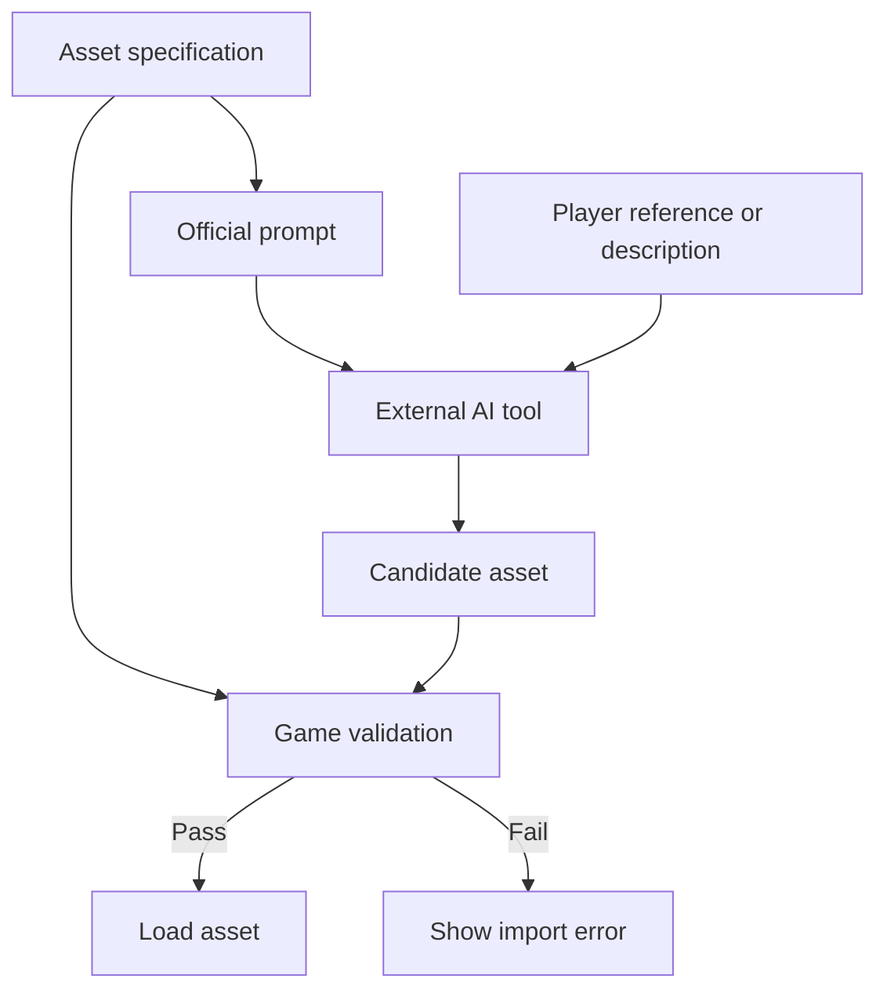

# Standards-Driven AI Game Asset Creation

**A workflow for creating importable game assets with external AI**

- **Author** [mizukidesuwa](https://github.com/mizukidesuwa)
- **Version** 0.1.0
- **Status** Architecture proposal with a reference implementation

## Core principle

**The same asset specification guides generation and defines what the game accepts.** The game publishes a versioned specification and a reusable prompt that expresses its requirements. Players give the prompt and their creative input to an external AI tool of their choice. The tool returns a candidate asset, which the game validates before loading.

The intended player workflow is to supply a reference image or description, generate an asset, and import the result. The game defines the format, supported features, and technical limits. The external tool handles generation, and the game controls how the accepted asset behaves at runtime.

## Reference implementation — FORZERO: BUDGET

[FORZERO: BUDGET](https://github.com/mizukidesuwa/forzero-budget) is a 3D cycling game with an import workflow for AI-generated rider skins. Players copy the official prompt from the workshop, submit it with a reference image to an external AI tool, then paste the resulting `SkinModelSpec` JSON or select it as a file and choose **Import and Preview**. [Import interface](https://github.com/mizukidesuwa/forzero-budget/blob/main/index.html#L234-L243)

The JSON describes a 3D rider using a color palette, body proportions, and a set of ellipsoids, tubes, and boxes. The game checks the specification version, permitted primitives and attachment points, model bounds, and triangle budget. It builds the rider’s appearance from the accepted data and applies its existing seated pose. [Game implementation](https://github.com/mizukidesuwa/forzero-budget/blob/main/game.js#L348)

This example illustrates a design choice that makes the workflow practical. The asset format gives the AI room to describe different silhouettes, colors, and details while keeping the geometry simple enough for the game to validate and render directly. Other asset types can expose different creative choices through their own specifications.

## Design principles

- **Define the contract first.** Specify supported fields, formats, coordinate systems, parameter ranges, and performance limits before writing the generation prompt.
- **Keep the prompt and validator aligned.** Update both when the specification changes so the published instructions reflect the game’s acceptance rules.
- **Put the constraints where they matter.** Expose creative choices such as colors, silhouettes, and supported accessories while keeping runtime behavior under the game’s control.
- **Keep generation tool-independent.** Any external tool that can produce a conforming asset can participate through the same import interface.
- **Make failures actionable.** Where possible, report which constraint failed so the player can use the feedback on the next generation attempt.

## Evaluating the workflow

Use the same reference images across two or more external AI tools. For each tool, compare runs with and without the official prompt while keeping the export format and generation settings fixed. Record first-pass import rates, the number of attempts, any manual corrections, and how well accepted riders preserve the reference’s visible features in-game.

A reproducible example should include the reference image, the exact prompt, the unedited generated JSON, and an in-game screenshot. A rejected sample with its validation error can show where the specification needs clearer instructions or where the generator struggles to follow them.
    
