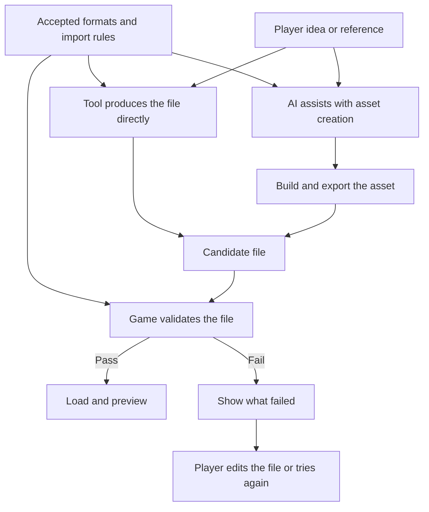
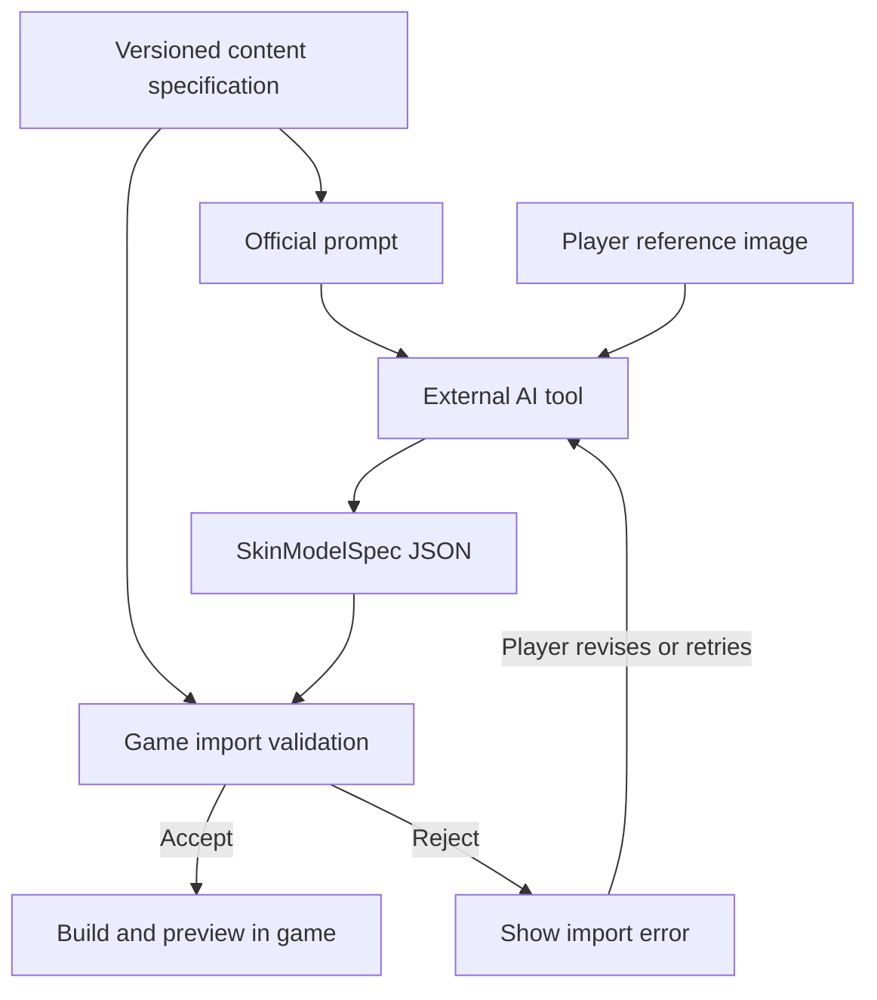

# Standards-Driven AI for Game UGC

An engineering approach for bringing AI-assisted user-generated content (UGC) into games.

- **Author** [mizukidesuwa](https://github.com/mizukidesuwa)
- **Version** 0.1.0
- **Status** Architecture proposal with a reference implementation

## The game defines what it accepts

The game publishes a versioned import specification for each type of UGC it supports. The specification says what the content can describe, which file formats players can submit, and what checks an asset must pass before the game loads it.

## Choosing the file format

- Choose a format that can express the choices players can make.
- Try it with a range of player inputs to see whether existing AI tools can produce usable files, directly or through an exporter.
- Check that the game can read and load the format and enforce its limits on size, complexity, and supported features.

A game can reuse an existing format when its tools and importer already support it. A game that builds assets from a small set of parameters can also define a format for those inputs.

## Changing the generation workflow

Take a game that accepts GLB models. One tool can produce a `.glb` file directly. Another workflow can use AI to produce parameters for a modeling tool, then export the resulting model to `.glb`. Both files go through the same game importer and checks.

For a tool that takes text instructions, the game can publish a prompt based on the specification. Its requirements should match the import checks so players can use an error message to revise the file or try again.

## Reference implementation — FORZERO: BUDGET

FORZERO: BUDGET uses a game-specific JSON format for rider skins. Players copy the workshop prompt and send it to an external AI tool with a reference image. They paste the returned `SkinModelSpec` JSON or select the file, then choose **Import and Preview**. [Game release](https://github.com/mizukidesuwa/forzero-budget/releases/tag/v2.6.5) · [Workshop interface](https://github.com/mizukidesuwa/forzero-budget/blob/1f57d956e5ef5661e597fff937bfa58e12374ba5/src/index.html#L300-L311)

The game already builds the rider and applies its riding poses. The JSON supplies colors, proportions, and shapes such as ellipsoids, tubes, and boxes. The importer checks the specification version, allowed shapes and attachment points, model bounds, and the estimated triangle count against the budget. [Official prompt](https://github.com/mizukidesuwa/forzero-budget/blob/1f57d956e5ef5661e597fff937bfa58e12374ba5/src/data/rider-skin-prompt.js) · [Skin validation](https://github.com/mizukidesuwa/forzero-budget/blob/1f57d956e5ef5661e597fff937bfa58e12374ba5/src/ride/rider-skin.js#L537-L609) · [Mesh construction](https://github.com/mizukidesuwa/forzero-budget/blob/1f57d956e5ef5661e597fff937bfa58e12374ba5/src/ride/models.js#L299-L323)

## Evaluating the workflow

Choose one type of UGC and one delivery format. Give two generation workflows the same set of player inputs and run the results through the same game importer. Record the first-pass import rate, the manual changes needed, and how closely the accepted result matches the player's input in the game.

For each example, publish the original input, the tool and instructions used, the unedited file, and a screenshot of the preview or the text of the import error.
