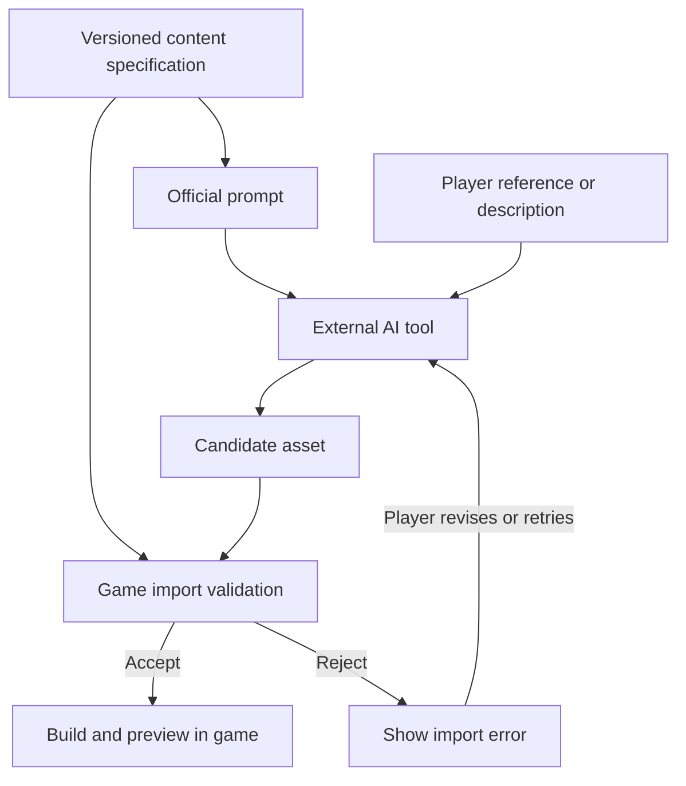

# Standards-Driven AI for Game UGC

An engineering approach for games that support user-generated content (UGC) made with external AI.

- **Author** [mizukidesuwa](https://github.com/mizukidesuwa)
- **Version** 0.1.0
- **Status** Architecture proposal with a reference implementation

## How it works

**The same specification guides generation and defines what the game accepts.** The game publishes a versioned specification for each supported type of content, along with a prompt based on it. Players give the prompt and a reference or description to an external AI tool of their choice, then bring the result back to the game for import.

The specification says what players can change, what format to use, and which limits apply. The game checks the data structure and game-specific rules such as size and complexity. It builds and previews assets that pass. If an import fails, players can use the error message to edit the file or ask the AI tool to try again.

The prompt needs to reflect the rules the importer actually uses. When a rule changes, update both and check one example that should pass and one that should fail. Each new content type needs its own specification and import checks.

## Reference implementation — FORZERO: BUDGET

FORZERO: BUDGET uses this workflow for rider skins. Players copy the workshop prompt and send it to an external AI tool with a reference image. They paste the returned `SkinModelSpec` JSON or select the file, then choose **Import and Preview**. [Game release](https://github.com/mizukidesuwa/forzero-budget/releases/tag/v2.6.5) · [Workshop interface](https://github.com/mizukidesuwa/forzero-budget/blob/1f57d956e5ef5661e597fff937bfa58e12374ba5/src/index.html#L300-L311)

The JSON describes the rider with colors, proportions, ellipsoids, tubes, and boxes. The importer checks the version, allowed shapes and attachment points, model bounds, and triangle budget. The game builds the rider from the accepted data and applies its existing riding poses. [Official prompt](https://github.com/mizukidesuwa/forzero-budget/blob/1f57d956e5ef5661e597fff937bfa58e12374ba5/src/data/rider-skin-prompt.js) · [Skin validation](https://github.com/mizukidesuwa/forzero-budget/blob/1f57d956e5ef5661e597fff937bfa58e12374ba5/src/ride/rider-skin.js#L537-L609) · [Mesh construction](https://github.com/mizukidesuwa/forzero-budget/blob/1f57d956e5ef5661e597fff937bfa58e12374ba5/src/ride/models.js#L299-L323)

## Evaluating the workflow

To see whether the prompt helps, use the same references across at least two AI tools. For each tool, compare a basic request with the official prompt while keeping the task, output format, and settings fixed. Record the first-pass import rate, retries, and manual edits. In the game, check which features of the reference the imported skin preserves.

For each published example, include the reference, exact prompt, unedited JSON, and a screenshot of the preview or the text of the import error.
